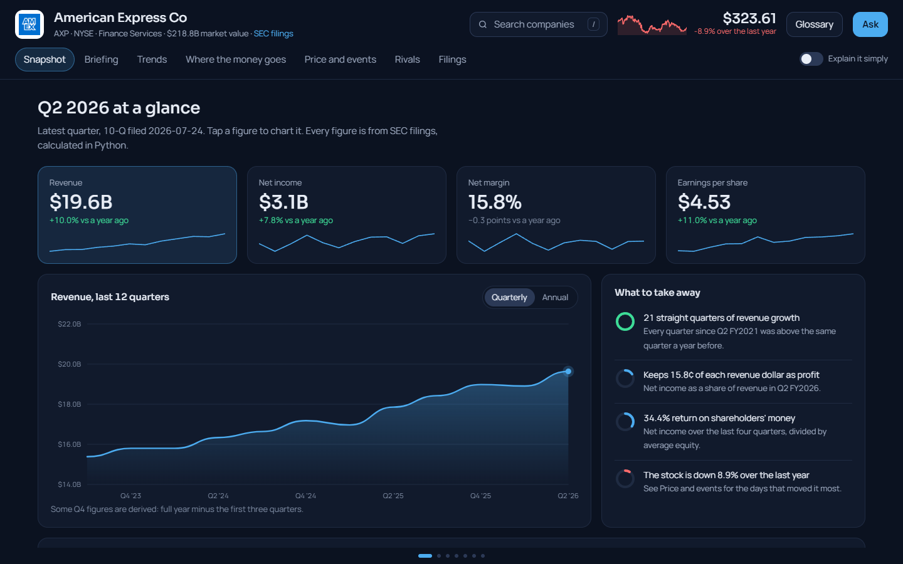
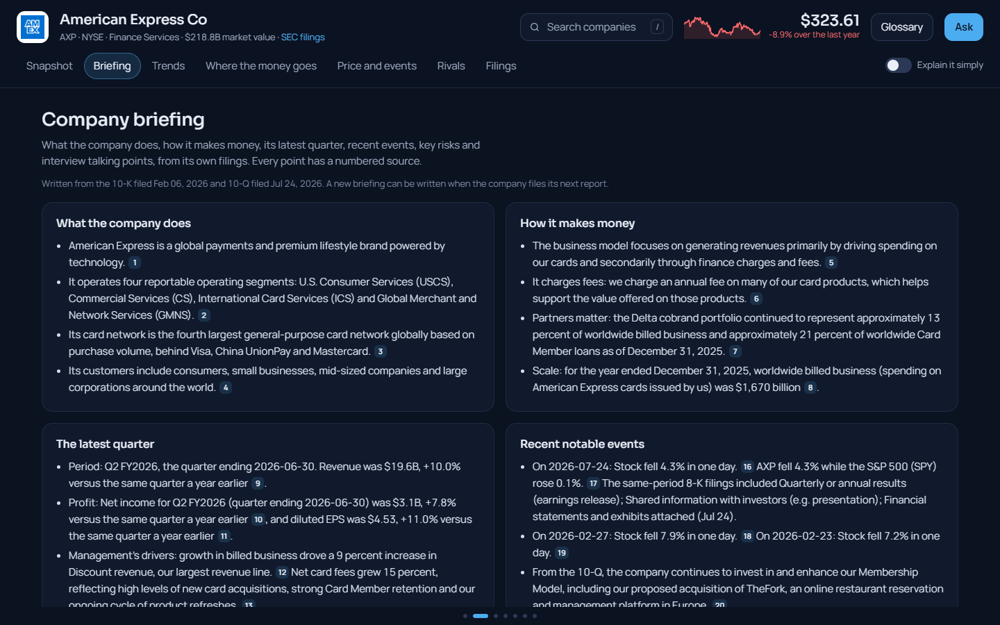
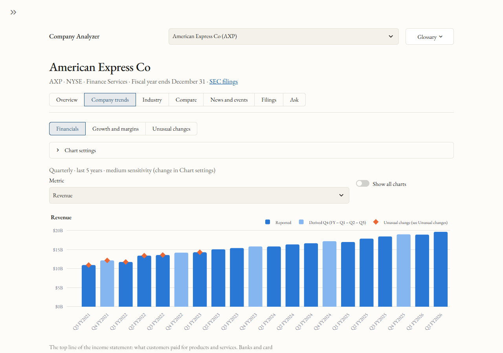
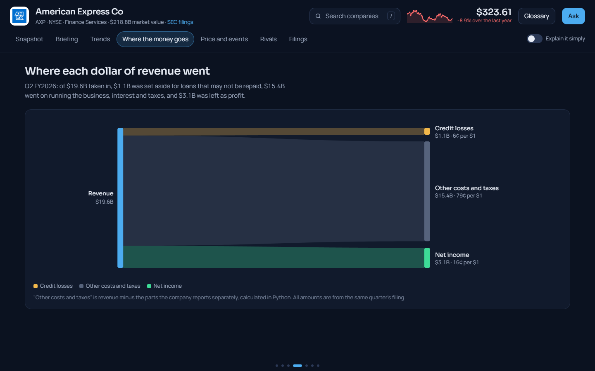
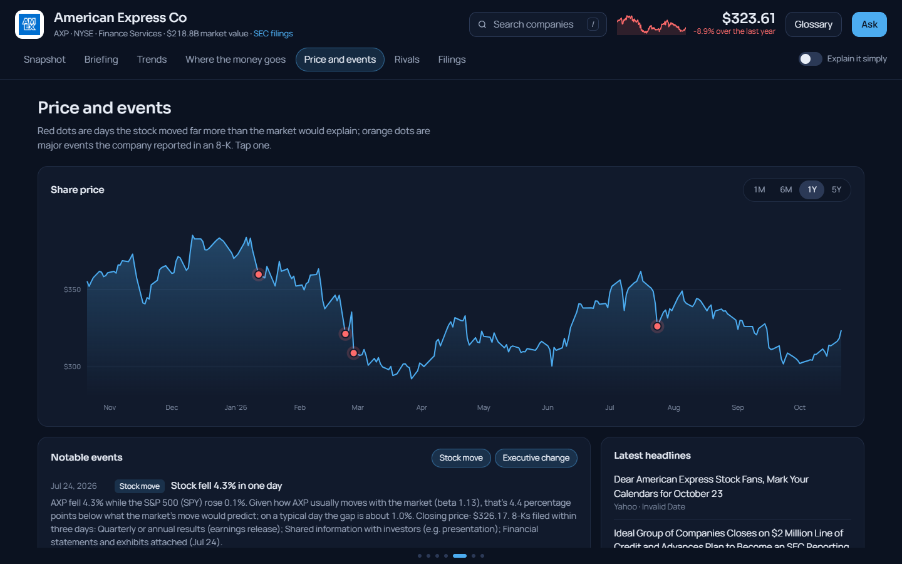
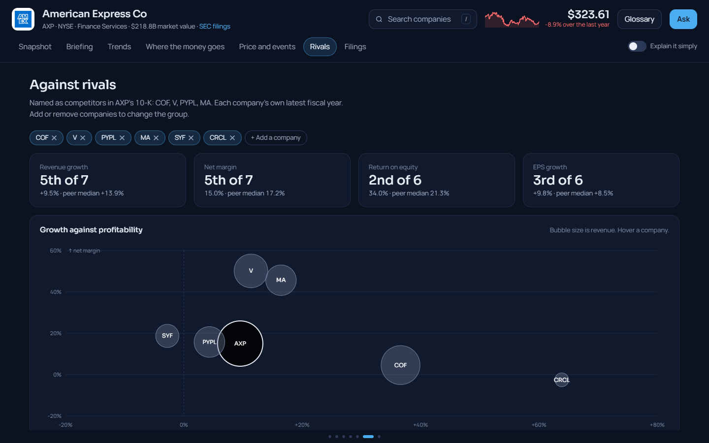
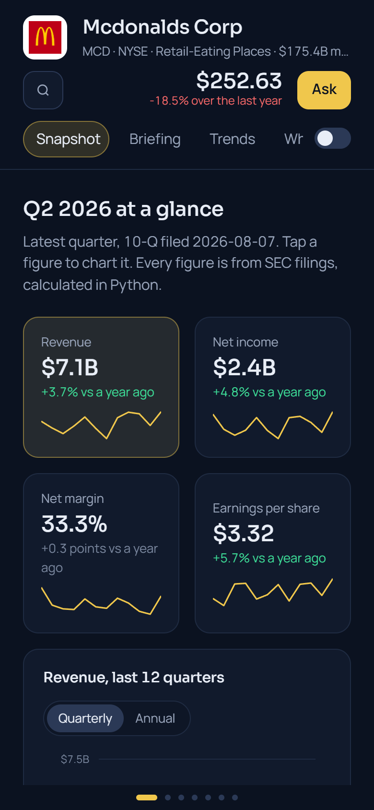

# Company Analyzer

A fast, single-page dashboard for understanding a public company's financial position.
Pick any company that files with the U.S. Securities and Exchange Commission (SEC): its
figures, trends, rivals, events and a cited briefing glide in side by side, coloured in the
company's own brand colour, with an AI assistant that answers from the company's filings.
Built with Python (data and calculations) and a hand-built web page (no front-end framework).

> **Status:** in development. See [BUILD_LOG.md](BUILD_LOG.md) for progress.

## Screenshots



| Briefing | Trends |
|---|---|
|  |  |
| **Where the money goes** | **Price and events** |
|  |  |
| **Rivals** | **On a phone** |
|  |  |

## The core rule: code does the numbers, AI does the words

- **Every number** (revenue, net income, EPS, growth rates, margins) comes straight from
  the SEC's structured XBRL data and is calculated in plain, tested Python.
- **The AI (Anthropic's Claude)** is used only to read filing text and answer questions,
  and it must cite the filing and section behind each point. If the filings don't answer
  a question, it says so instead of guessing. It never sees or calculates the financials.

## Roadmap

**Version 1 (in progress)**
1. ✅ Ticker input (defaults to AXP)
2. ✅ Key financials from SEC EDGAR, with quarterly and annual charts. The exact EDGAR
   label used for each metric is shown on screen.
3. ✅ Growth rates, margins, and return on equity calculated in Python, plus automatic
   flagging of unusual changes ("notable events")
3b. ✅ Redesign: EB Garamond theme; calm Overview with charts on request; search by
   company name or ticker; Industry section (editable peer group, peer medians, ranking);
   Compare up to five companies; Headlines from Finnhub
4. ✅ Filings list: latest 10-K, 10-Q and 8-K filings with links, and 8-K event types in
   plain English
5. ✅ Ask: a chat assistant that answers from the filings and the dashboard's own figures,
   with numbered, quoted sources (Claude Haiku 5.5 with the Citations feature)
   - 5b. ✅ "Explain from filing": management's own explanation of each unusual change and
     notable event, from the filing that covers it (including 8-K press releases), cited
   - 5c. ✅ Company synopsis on the Overview: what the company does, how it makes money,
     its latest quarter, recent events, key risks and interview talking points, all cited
     and written once per new 10-K or 10-Q
6. ✅ Polish: speed-ups, a design review (Apple's design principles, web interface
   guidelines, app-screen typography and layout), README screenshots.
7. ✅ The web dashboard: a rebuild of the screen as a smooth single-page site (panels that
   glide sideways, charts that morph, a chat drawer, company logos and brand colours),
   about 10x faster than the Streamlit version, with every feature carried over.
8. ✅ Industry and world: the stock against its sector and the S&P 500, the industry's
   drivers in the company's own words (10-K, cited), live economic indicators (FRED), and
   "What's happening now", a cited summary of recent news from a web search (on request,
   about 6-7¢, saved for the day). A public link is next.

**Version 2: macro layer and segments**
- Macro data from FRED (interest rates, oil, consumer credit, card delinquencies)
- The company's own disclosed sensitivity to those factors (10-K Item 7A and risk factors)
- Historical news from GDELT's bulk data files (for the Version 3 model), not website scraping
- Business segment breakdowns pulled from the filings

**Version 3: predictive model**
- Direction of a company or industry from macro trends and fundamentals, backtested on
  past data, shown as probabilities with their main drivers (criteria to be defined)

## Running it yourself

Requires Python 3.11 or newer.

```bash
python -m venv .venv
.venv\Scripts\activate          # on Mac/Linux: source .venv/bin/activate
pip install -r requirements.txt
```

Copy `.streamlit/secrets.toml.example` to `.streamlit/secrets.toml` and fill in:
- `SEC_USER_AGENT`: your name and email (the SEC requires this on every request)
- `ANTHROPIC_API_KEY`: your key from the Anthropic Console
- `FINNHUB_API_KEY`: a free key from finnhub.io (for headlines)
- `TIINGO_API_KEY`: a free token from tiingo.com (for daily stock prices)
- `FRED_API_KEY`: a free key from fredaccount.stlouisfed.org (for industry indicators)

Then start the dashboard:

```bash
python -m webapp.server
```

and open http://127.0.0.1:8600. On Windows you can instead double-click
`start_dashboard.bat`, which starts it and opens your browser. Keep its window open while
you use the dashboard. Only this computer can open it.

The earlier Streamlit version still works (`streamlit run app.py`, or
`start_classic_dashboard.bat`).

## Checking the code

```bash
pip install -r requirements-dev.txt
python -m pytest          # automated tests
ruff check .              # linter (settings in ruff.toml)
```

## Project layout

```
webapp/                the web dashboard
  server.py            serves the page and each panel's data (Starlette, local only)
  payloads.py          what each panel shows, calculated in Python
  service.py           loading and remembering data, side by side where possible
  ai.py                the briefing, "explain this" and the chat, streamed live
  static/              the page: index.html, app.css, app.js, charts.js (hand-drawn SVG)
app.py, ui/            the earlier Streamlit version
analyzer/              all data and math: SEC client, data cleaning, metrics,
                       peers, comparisons, headlines, filing reader, search, assistant
tests/                 automated checks for every calculation and cleaning rule
.streamlit/            theme (EB Garamond) and settings; private secrets (never uploaded)
BUILD_LOG.md           what was built, what broke, and how it was fixed
```

## Data sources

- [SEC EDGAR APIs](https://www.sec.gov/search-filings/edgar-application-programming-interfaces):
  company facts (XBRL), submissions, industry lists, and "frames" (one figure for every company)
- [Finnhub](https://finnhub.io/): company news by ticker, for headlines, and company
  logos, websites and market values (free key)
- [Tiingo](https://www.tiingo.com/): daily stock prices, for big-move detection (free key)
- [FRED](https://fred.stlouisfed.org/): the Federal Reserve's economic data, for industry
  indicators such as oil prices, interest rates and retail sales (free key)
- [Anthropic Claude API](https://docs.anthropic.com/): the assistant (Claude Haiku 5.5, with
  Citations, and web search for the industry news summary)
